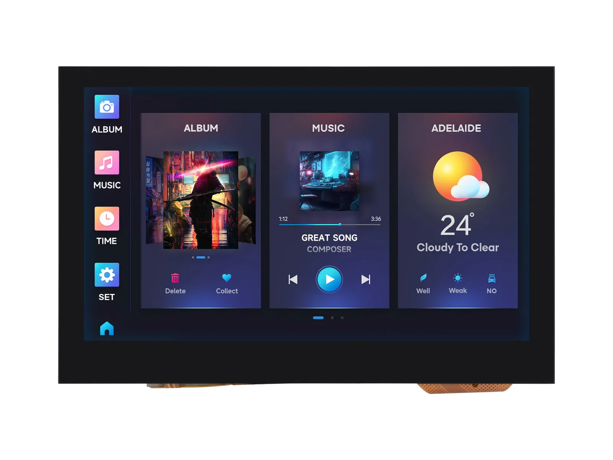

# Waveshare ESP32-S3-Touch-LCD-4.3C Product Engineering Sample Program

[中文](README_ZH.md)

The ESP32-S3-Touch-LCD-4.3 integrates large-capacity Flash and PSRAM, and has an on-board 4.3-inch wide capacitive touch LCD screen, which can smoothly run GUI interface programs such as LVGL; 
it combines multiple peripheral interfaces (such as CAN, I2C and RS485 interfaces) to quickly develop HMI and other applications for the ESP32-S3. 
A variety of functions and interfaces meet the power consumption needs of application scenarios such as the Internet of Things (IoT), mobile devices, and smart homes.

- [Purchase Link](https://www.waveshare.com/esp32-s3-touch-lcd-4.3c.htm)
- [Documentation](https://docs.waveshare.com/ESP32-S3-Touch-LCD-4.3C)

---

## 🔧 Configuration

You can find detailed configuration information on the product wiki page

---

## 🛠️ Contributing

We welcome contributions! Here’s how you can help:

1. Fork the repository.
2. Create a new branch for your feature or bug fix.
3. Commit your changes with clear descriptions.
4. Submit a pull request for review.

---

## 🧩 Issues and Support

If you encounter any issues:

- Check the [Issues](https://github.com/waveshareteam/ESP32-S3-Touch-LCD-4.3C/issues) section.
- Create a new issue with detailed information.
- Refer to the documentation for troubleshooting tips.
- Contact the Waveshare team and provide the order number to obtain technical support.

---

## 📜 License

This repository is licensed under the Apache License License. See the [LICENSE](LICENSE) file for details.

---

## 🙌 Acknowledgments

- Waveshare for their excellent hardware platforms and software support
- The Espressif Team for their continuous support.
- Open-source contributors who make these projects possible.

---

Thank you for using Waveshare Electronics Products! 🚀